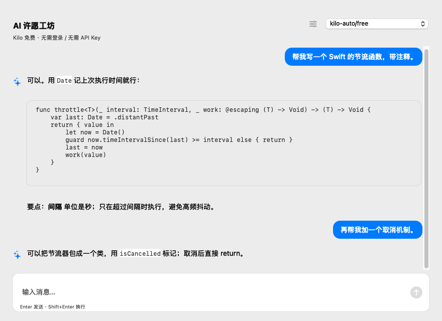

# AI Workshop · LLM 接入层

Mipad DP Touch 的独立插件（未完成）：统一模型服务 + 模型配置界面。

**当前进度：M1 核心（LLM 层）已完成并通过真实联网验证；UI / LiteLLM 待做。**

## 为什么是插件

- 不内置进 mipad-dp-touch 主程序；宿主只加一条插件注册表。
- 插件按需加载（用户点「显示」才 import），不用不占内存。
- LLM 核心不依赖 AppKit、不依赖宿主，可整体搬到别的项目。

## 目录

```
aiworkshop_plugin/
  llm/                  # ★ 可移植核心（纯标准库）
    client.py           #   LLMClient：providers / list_models / stream / test
    types.py            #   Chunk / ModelInfo / Usage / TestResult
    errors.py           #   LLMError（统一 8 类错误）
    backends/
      kilo.py           #   Kilo 免费通道：匿名、零依赖、SSE
      openai_compat.py  #   OpenRouter / DeepSeek / OpenCode Go / Gemini(OpenAI 口)
  __init__.py           #   插件入口（M1 后补 create/show/hide）
tests/test_llm_offline.py
tools/smoke_kilo.py
```

## 已实测（2026-11）

- `GET https://ai-gateway.kilo.ai/api/v1/models` 匿名 200，17 个免费模型；
- `POST /chat/completions` 完全不带 `Authorization` 也能用；
- `stream=true` 返回 SSE，`delta` 里同时有 `content` 与 `reasoning`；
- `kilo-auto/free` 自动路由（实测落到 `nvidia/nemotron-3.5-super-vl:free`）。

## 用法

```python
from aiworkshop_plugin.llm import LLMClient

c = LLMClient()
models = c.list_models("kilo")                 # 免费模型
for ch in c.stream("kilo", "kilo-auto/free",
                   [{"role": "user", "content": "你好"}]):
    if ch.type == "content":
        print(ch.text, end="")
```

自定义 API：

```python
c = LLMClient({"openrouter": {"key": "sk-or-...", "model": "anthropic/claude-sonnet-4.5"}})
for ch in c.stream("openrouter", "", [{"role": "user", "content": "hi"}]):
    ...
```

## 界面



深色模式：`docs/ui-dark.png`。

* 用户消息：右对齐 accent 气泡、白字；
* 助手消息：图标 + 正文 + 独立代码块（圆角、等宽、横向滚动）；
* 输入框：中性卡片、圆形发送键（空输入置灰）、Enter 发送 / Shift+Enter 换行；
* 空状态：星标 + 三个示例问题；流式输出带光标，可随时停止。

生成预览：`python3 tools/preview_ui.py /tmp/ui.png`（`PREVIEW_DARK=1` 出深色版）。

## 自检

```bash
python3 tests/test_llm_offline.py   # 14 项，离线；本地假 SSE 服务
python3 tools/smoke_kilo.py         # 真实联网冒烟（不需要 Key）
```

## 设计约束

- **Kilo 不经过 LiteLLM**：只想免费对话的用户不加载任何重依赖。
- **LiteLLM 只做可选后端**：宿主是 PyInstaller 包、没有 pip；litellm 体量也超插件 20 MB 上限，所以只能是按需 sidecar，不能内置。
- **统一 Client**：UI 只认 provider id 与 `Chunk`，不接触各家 JSON。
- **错误不静默**：401/403/429/5xx/超时/坏流都映射成可读中文。
